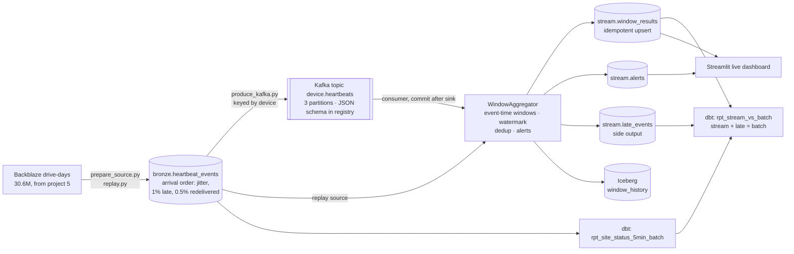

# Real-Time Device Telemetry Stream

[](https://github.com/Saigwe/device-telemetry-streaming/actions/workflows/ci.yml)

> Device heartbeats processed as a stream, using event-time windows with a watermark, deduplication, a late-data side output and threshold alerts. CI runs it end to end through Kafka (Redpanda, with schema registry). Locally it processes 30.7 million real heartbeats in 3.5 minutes, and every window reconciles to a batch reference.

**Author:** Stanley Igwe, Lead Data (Analytics) Engineer · [Portfolio](https://saigwe.github.io)
**Stack:** Python · Kafka API (Redpanda) · Apache Iceberg (pyiceberg) · DuckDB · dbt Core · Streamlit · pytest · GitHub Actions
**Status:** Core build complete and run on a full real quarter. See [Roadmap](#roadmap) for Flink, ClickHouse and Grafana.

This is the streaming version of the device-estate reporting I led at a workplace-communications hardware company: alerts as devices fail, not in the next day's report. The data is Backblaze's real drive fleet (project 5 of my plan), replayed as heartbeats; no employer data is used.

---

## 90-second summary
| | |
|---|---|
| **Problem** | A daily batch report tells operations about failing devices a day late. Moving to streaming brings three new problems: events arrive out of order, some arrive twice, and some arrive after their window has been published. |
| **What I built** | A stream processor: event-time 5-minute windows per site, a watermark with 120 s allowed lateness, dedup on event id, a late-event side output and threshold alerts. It writes to an idempotent serving table and an Iceberg history table, with a dbt batch reference that the stream must reconcile to. |
| **Why it matters** | Operations get alerts within minutes, and the live numbers can be trusted because every event is accounted for. Published numbers never change after the fact, and a crash or replay can't double-count. |
| **Proof** | 30,750,460 deliveries at 148k events/s. Every one of the 540 windows reconciles (stream + late = batch, 0 unexplained), and the batch matches Backblaze's 1,030 failures exactly. Through real Kafka in CI, per-partition watermarks cut late events from 59% to 0.3%, with 0.4 s median latency. See [Numbers](#numbers). |

## Architecture


## How the stream works
- **Time compression:** one Backblaze day becomes one 5-minute window per datacenter (site). The stream's failure counts can then be checked against the real daily failures.
- **Messy delivery, on purpose:**
  - every event arrives 0–20 s after it happened
  - 1% arrive 150–600 s late
  - 0.5% are delivered twice (at-least-once)
  - in Kafka mode, 3 partitions interleave the order further
- **Watermark** = the minimum, across Kafka partitions, of each partition's latest event time, minus 120 s (per-partition watermarks, as in Flink). A window is published when the watermark passes its end. Taking the minimum stops one fast partition from closing windows the others are still filling. Events for an already-published window go to `stream.late_events`; they are not merged in, because a number someone may have acted on shouldn't silently change.
- **Effectively-once:**
  1. Offsets are committed only after the sink write.
  2. Event ids are deduplicated.
  3. The serving table is upserted by (site, window_start).

  A crash replays input but can't double-count. A test shows replaying the same input, part of it twice, gives identical results.
- **Iceberg history:** every micro-batch is an append commit (90 snapshots on the full run), so you can see what was published when.
- **Trade-offs** (batch vs streaming, lateness vs latency, exactly-once vs effectively-once, what changes at 10×) are in the [design doc](docs/design_doc.md).

## Tests
- **pytest, 10 tests on the engine:**
  - windows close only after the watermark passes
  - out-of-order events within the lateness are counted
  - late events go to the side output, not the result
  - duplicates are dropped
  - distinct failed devices per site
  - alerts fire at the threshold
  - replay is deterministic
  - a fast partition doesn't close a slow partition's windows
  - received = counted + late + duplicates
- **dbt reconciliation:**
  - `assert_stream_reconciles_to_batch`: in every window, batch events = stream events + late events, and failed devices differ only by late failures
  - `assert_batch_matches_source`: after dedup, every window holds exactly one heartbeat per drive-day and its failures equal the datacenter-day's failures in the source
  - `assert_no_duplicate_published_windows`
- **Mutation check:** deleting 5 late events from the side output makes the reconciliation fail in 3 windows, as it should.
- **CI has two jobs:**
  - replay + dbt
  - a real Kafka run: Redpanda in Docker, JSON schema registered, a 3-partition topic, consumer and producer running together, then the same dbt reconciliation

## Numbers
Full real-data run on a Windows laptop: Backblaze Q1 2026, 90 days. Reproduce with `make all` after building project 5's warehouse.

| Metric | Value |
|---|---|
| Drive-days replayed / deliveries (incl. redeliveries) | 30,597,484 / 30,750,460 |
| Duplicates dropped | 152,976 |
| Late events to side output (arrived after their window closed) | 220,306 (0.72%) |
| Counted live | 30,377,178 |
| Windows published (6 sites × 90) | 540 |
| **Reconciliation: unexplained events across all windows** | **0** |
| Failures: counted live / arrived late / total (= Backblaze's count) | 1,023 / 7 / **1,030** |
| Alerts (≥ 6 failed devices in a site-window) | 41: sac2 21, phx1 9, sac0 7, iad1 3, ams5 1 |
| Processing time / throughput | 207 s / **148,463 events/s** (single Python process) |
| Publish delay after window end (simulated time, p50 and p95) | 120 s / 120 s (= the allowed lateness) |
| Peak state: open windows / dedup ids | 12 / 1.5M |
| Iceberg snapshots (one per micro-batch) | 90 |
| Prepare 30.6M drive-days into the event log / dbt reconciliation | 208 s / 8 s |

The 7 late failures show the trade-off in the design doc in practice. The live view missed them when it published, and the batch reference has them. A longer allowed lateness would catch more, but every window would publish later.

**Through real Kafka (CI, Redpanda, 3 partitions, fixture stream of 39,929 deliveries):**

| | First Kafka run (single watermark) | With per-partition watermarks |
|---|---|---|
| Late events to side output | 23,710 (59.4%) | **115 (0.29%)** |
| Reconciles to batch | yes | yes |
| Producer-to-published latency, p50 / p95 | not measured | **0.41 s / 1.41 s** |

The first run reconciled (every event was accounted for), but 59% of events arrived "late". The producer had published everything in 0.4 s, so the consumer read one partition ahead of the others, and the watermark followed the fastest one. Taking the minimum across partitions fixed it. The replay never showed the problem, because it has a single ordered input, which is why the Kafka path is tested on its own in CI. Kafka-mode throughput (about 1.9k events/s) includes 15 s of idle wait at the end of the bounded run, so it isn't a capacity figure.

## How to run
Requires **Python 3.12** (what CI uses) and `make`, or run the commands in the `Makefile` by hand.
```bash
python -m venv .venv && source .venv/bin/activate   # Windows: .venv\Scripts\activate
pip install -r requirements.txt
make all            # real data: needs ../device-fleet-reliability/warehouse/fleet.duckdb (project 5)
make fixture-all    # synthetic drive-days (CI)
pip install streamlit && make dashboard
```
Through Kafka (needs Docker):
```bash
pip install -r requirements-kafka.txt && docker compose up -d
python scripts/run_stream.py --db warehouse/telemetry.duckdb --source kafka &
python scripts/produce_kafka.py --db warehouse/telemetry.duckdb --schema-registry http://localhost:8081
```

## Roadmap
- [x] Replay of real heartbeats with jitter, late arrivals and redeliveries; Kafka producer with a JSON schema in the registry
- [x] Event-time windows, watermark, dedup, late side output, alerts (pytest)
- [x] Idempotent serving sink and Iceberg history; commit-after-sink consumer
- [x] dbt batch reference and stream-vs-batch reconciliation, checked against the source
- [x] Design doc: batch vs streaming, lateness vs latency, exactly-once vs effectively-once
- [x] Per-partition watermarks (found and fixed through the Kafka CI run)
- [ ] Idle-partition handling (a partition with no traffic currently holds the watermark back)
- [ ] Run on Apache Flink (keyed state) and compare results
- [ ] ClickHouse serving table and a Grafana dashboard (needs Docker locally)
- [ ] Alerts as a rate per 1,000 devices on site, not a fixed count
- [ ] 3-minute Loom walkthrough ([script ready](docs/walkthrough.md))

## Interview topics this project prepares
- Event time vs processing time; watermarks and late data
- At-least-once delivery, deduplication and idempotent sinks (effectively-once)
- Kafka partitioning and keys; schema registry
- Proving a stream correct against a batch reference
- Streaming system design trade-offs

## Data and licence
- **Data:** [Backblaze Drive Stats](https://www.backblaze.com/cloud-storage/resources/hard-drive-test-data), © Backblaze, used as Backblaze asks: cited as the source and not sold. The heartbeat timing and delivery faults are simulated.
- **Code:** MIT (see `LICENSE`).
