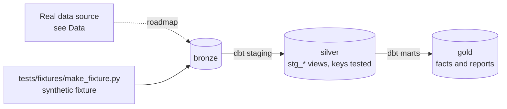

# Real-Time Device Telemetry Stream

[](https://github.com/Saigwe/device-telemetry-streaming/actions/workflows/ci.yml)

> Device heartbeats streamed through Kafka with windowed failure alerts, watermarks for late data and deduplication for effectively-once results, plus a batch reference implementation that proves the streaming numbers.

**Author:** Stanley Igwe, Lead Data (Analytics) Engineer · [Portfolio](https://saigwe.github.io)
**Stack:** Kafka (Redpanda in Docker) · Apache Flink or Spark Structured Streaming · Apache Iceberg or ClickHouse · Grafana · dbt Core (batch reference)
**Status:** 🚧 Scaffolded. Fixture pipeline passes: `dbt build` 11/11. See [Roadmap](#roadmap).

Project 7 of my portfolio plan. The streaming version of the device-estate reporting I led at a workplace-communications hardware company: alerts as devices fail, not the next day. This repo rebuilds the problem on public and synthetic data. No employer or client data, code or logic is used.

---

## 90-second summary
| | |
|---|---|
| **Problem** | TODO: one sentence on the business problem. |
| **What I built** | TODO: fill in as the roadmap lands. |
| **Why it matters** | TODO: the decision this enables, in the user's words. |
| **Proof** | TODO: link to [Numbers](#numbers), with every claim reproducible. |

## Architecture


## Data
A Python producer replays [Backblaze](https://www.backblaze.com/cloud-storage/resources/hard-drive-test-data) data or simulated heartbeats at speed, with duplicate and out-of-order events on purpose. CI checks the batch reference implementation on a synthetic fixture with planted duplicates and late events.

| Bronze table (fixture) | Rows |
|---|---|
| `bronze.devices` | 200 |
| `bronze.heartbeats` | 20,000 + 300 planted duplicates |

## Data model (gold layer, first cut)
| Model | Purpose |
|---|---|
| `rpt_site_status_5min` | Batch reference for the streaming job: 5-minute windows per site on event time. |

## Tests in place
- Staging: `unique` / `not_null` on every key, and `relationships` on every foreign key
- Marts: grain tests (`unique_combination`) and accepted values
- Business rules: `assert_late_events_not_more_than_events`

## Numbers
*(Fill from real runs. Never estimate.)*
| Metric | Value |
|---|---|
| Rows processed (real data) | _tbd_ |
| dbt models / tests | _tbd_ |
| `dbt build` runtime | _tbd_ |

## How to run
Requires **Python 3.12** (what CI uses) and `make`, or run the commands in the `Makefile` by hand.
```bash
python -m venv .venv && source .venv/bin/activate   # Windows: .venv\Scripts\activate
pip install -r requirements.txt
make fixture-all   # synthetic fixture -> dbt build (used in CI)
```

## Roadmap
- [x] Scaffold: synthetic fixture, staging with key tests, first marts and business-rule tests, CI
- [ ] Producer: replay heartbeats to a Redpanda topic, with a schema in the schema registry
- [ ] Streaming job: 5-minute windows per site with a 2-minute watermark and dedup on event_id
- [ ] Sinks: Iceberg for history, ClickHouse for the live Grafana dashboard
- [ ] Alert when the failed-device count in a window breaches a threshold
- [ ] Compare streaming output with the dbt batch reference (`rpt_site_status_5min`) and report any mismatch
- [ ] Design doc: batch vs streaming trade-offs, exactly-once vs effectively-once, end-to-end latency
- [ ] Fill in [Numbers](#numbers) and the [design doc](docs/design_doc.md)
- [ ] 3-minute Loom walkthrough

## Interview topics this project prepares
- Event time vs processing time
- Watermarks and late data
- Exactly-once and idempotent sinks
- Streaming system design

## Data and licence
- **Fixture:** synthetic, generated with a fixed seed by `tests/fixtures/make_fixture.py` from `fixture_spec.yml`. It describes no real company or person.
- **Real data:** see [Data](#data) for each source's own licence and terms.
- **Code:** MIT (see `LICENSE`).
